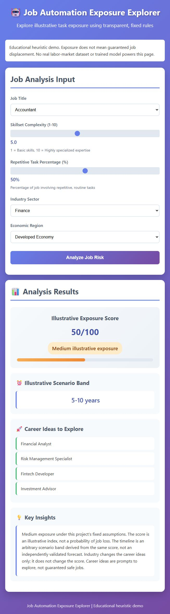

# Job Automation Exposure Explorer

A lightweight educational calculator for exploring fixed assumptions about task automation exposure.

  



## Overview

The main application is a static HTML, CSS, and JavaScript page. It uses a deterministic heuristic, **not a trained machine-learning model**. No backend, API keys, accounts, or real labor-market dataset are required. Exposure is not guaranteed job displacement; the score is not a probability.

- Select a listed occupation, industry, and economic region.
- Adjust skill complexity (1–10) and repetitive tasks (0–100%).
- Inspect the exposure score, illustrative scenario band, and career ideas.
- Use keyboard-accessible controls with reduced-motion support.

## Run locally

```sh
git clone https://github.com/shazeel-ahmed31/Job-Displacement-Model.git
cd Job-Displacement-Model
python -m http.server 8000
```

Open http://localhost:8000. Python is only a convenient static server; opening `index.html` directly also works. No npm installation or build is needed to use the page.

## Methodology

The original browser formula is preserved and extracted into `scripts/exposure.js`:

```text
raw = 50 + (repetitive_percentage - 50) × 0.8
         - (skillset_complexity - 5) × 8 + occupation_adjustment
regional = raw × 0.8 for Developing; raw otherwise
score = round(clamp(regional, 0, 100), 1 decimal)
```

Occupation adjustment is +20 for Data Entry Clerk, Cashier, Assembly Line Worker, and Bank Teller; −25 for Software Developer, Doctor, Teacher, and Lawyer; zero otherwise. Industry controls career suggestions only, not the score. The region multiplier and occupation weights are arbitrary project assumptions, not measured evidence.

| Displayed score | Exposure label | Illustrative scenario band |
| --- | --- | --- |
| 0–20 | Low | 20+ years |
| >20–40 | Low | 10–20 years |
| >40–70 | Medium | 5–10 years |
| >70–100 | High | 0–5 years |

These year bands are fixed mappings, not validated forecasts. They have no reference date and should not guide employment decisions.

Examples in a Developed region: Accountant with complexity 5 and 50% repetition scores 50; Data Entry Clerk with complexity 2 and 85% repetition yields 122 before clamping, displayed as 100; Software Developer with complexity 9 and 25% repetition yields −27, displayed as 0. The baseline Accountant example in a Developing region scores 40.

Inputs are checked against the supported categories and finite numerical ranges. Labels and bands use the rounded displayed score, avoiding contradictory boundary results.

## Project structure

```text
index.html                         Form and results
styles.css                         Layout, focus, motion preferences
scripts/exposure.js                Pure validated heuristic
scripts/app.js                     Browser interactions and text rendering
scripts/job_displacement_model.py   Separate synthetic-data experiment
requirements-experiment.txt        Optional experiment dependencies
tests/exposure.test.js              Calculator regression tests
docs/calculator.jpg                Actual application screenshot
.github/workflows/check.yml         Syntax checks and tests
```

## Testing

Node.js 22 or later is needed for checks, with no third-party JavaScript dependencies:

```sh
npm run check
npm test
```

If Windows prevents the test runner spawning a process, use:

```sh
node --test --experimental-test-isolation=none tests/exposure.test.js
```

The five test groups cover examples, invalid values, score boundaries, monotonicity, region effects, deterministic results, and industry suggestions. Browser submission, result focus, and mobile layout were also checked locally. CI performs JavaScript syntax checks and the calculator tests; it does not validate scientific accuracy.

## Optional Python experiment

The retained Python script trains random-forest regression and classification models on generated synthetic examples. It **does not power the webpage** and does not establish real-world predictive validity. Encoders and scaling are now fitted on training rows only. Categories unseen during training receive −1, an experimental fallback that may produce unreliable predictions.

```sh
python -m venv .venv
# Activate the environment using your platform's normal command.
python -m pip install -r requirements-experiment.txt
python scripts/job_displacement_model.py
```

Running it writes ignored model files to the current directory. Load only your own trusted model files: joblib uses pickle-based serialization. The experiment was syntax-checked, but training and its metrics were not verified in this audit. Browser and Python algorithms differ intentionally; they must not be treated as interchangeable.

## Limitations and next improvements

No empirical dataset or citations support the current weights. Career ideas are fixed suggestions, not guaranteed safe occupations. Economic-region categories are coarse assumptions. There is no live deployment verified for this repository.

Future work could replace arbitrary weights with cited evidence, validate against independent real-world observations, improve category handling in the separate experiment, and add automated browser tests.

## Author and license

Created by [Shazeel Ahmed](https://github.com/shazeel-ahmed31). No license file is currently included; no open-source license grant is implied.
